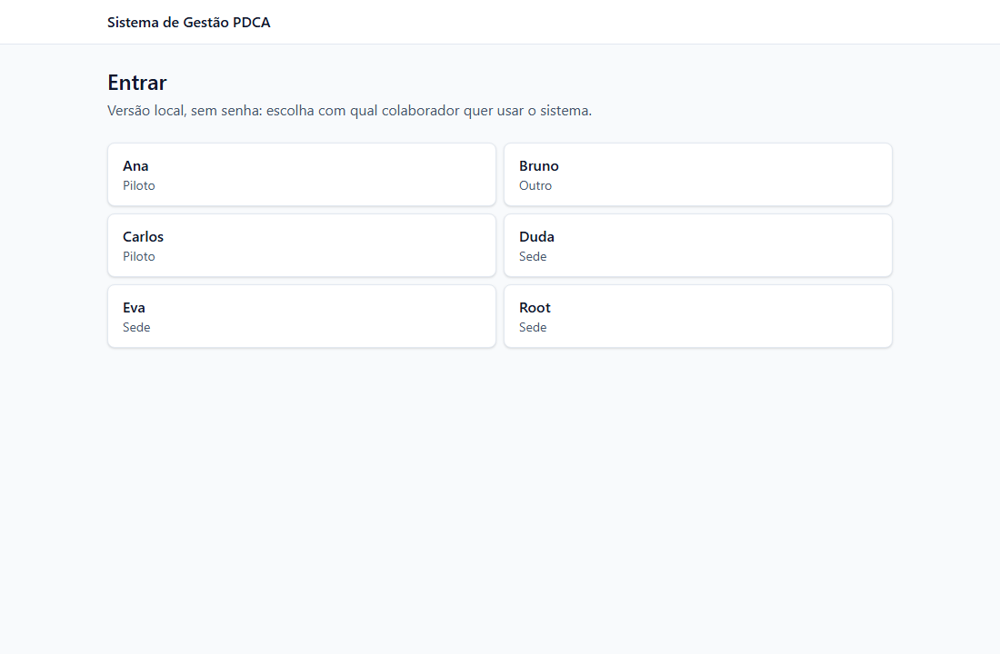
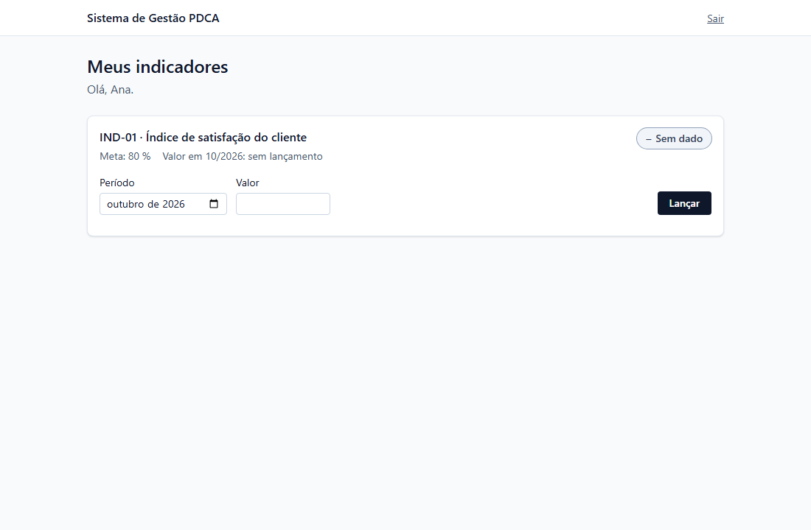
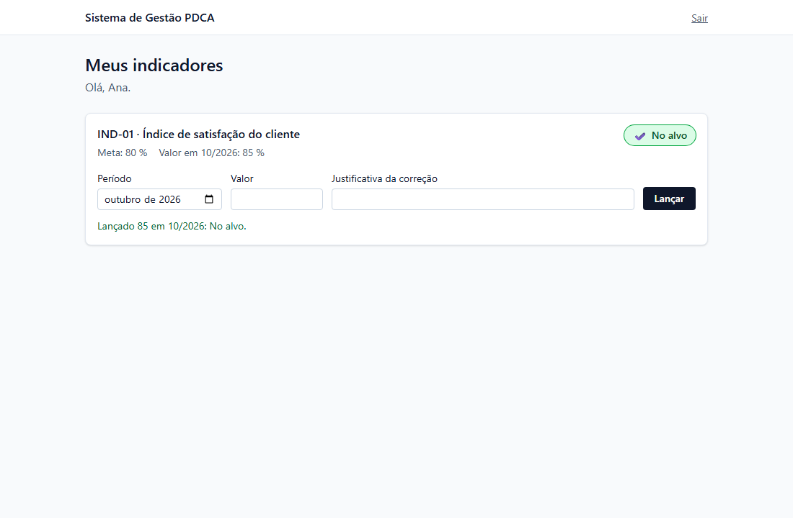
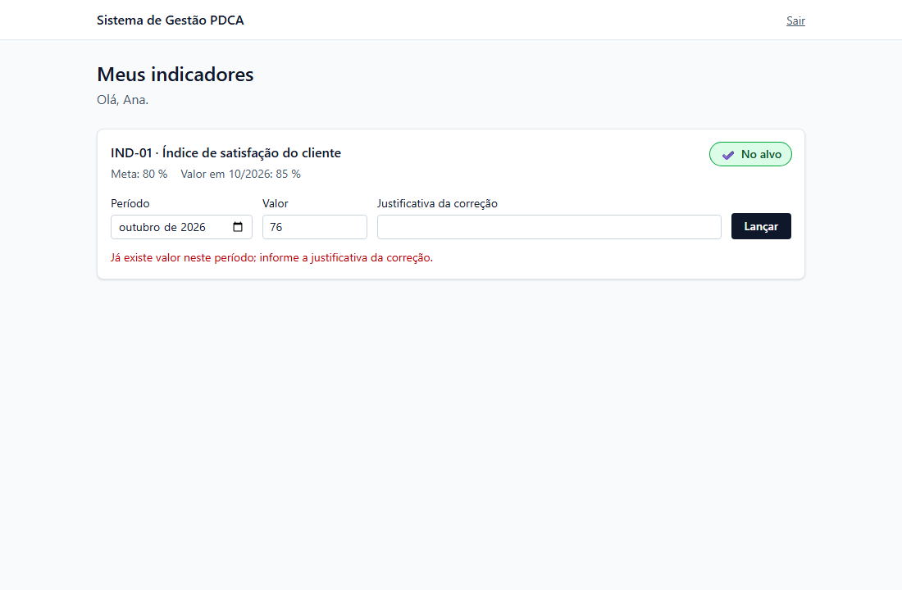
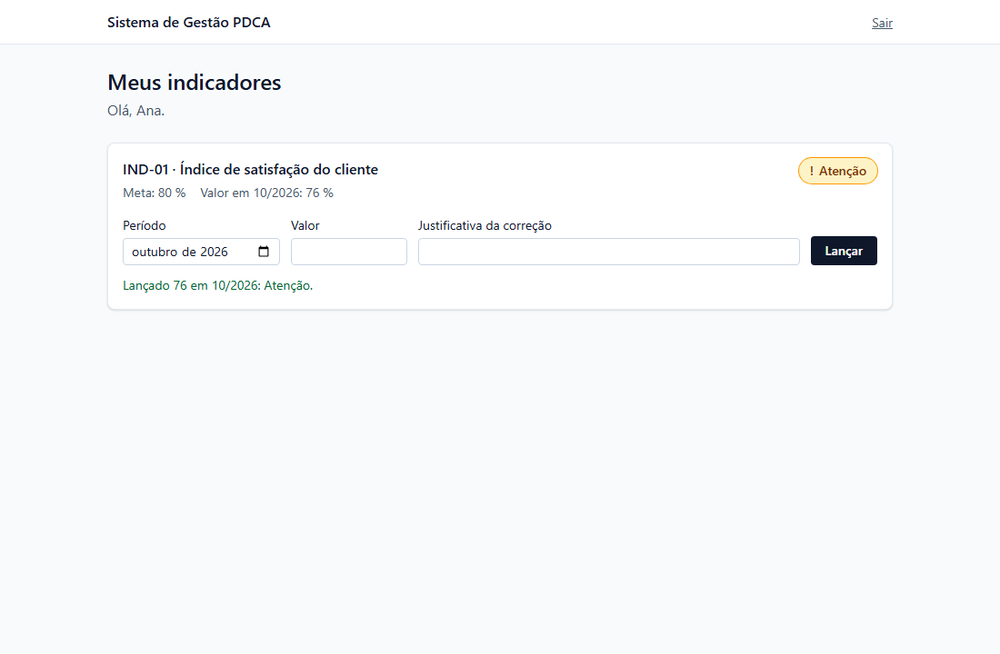

# Walkthrough F00 · Esqueleto andante

Verificação feita em 2026-10-28 na branch `fatia/F00-esqueleto`, no commit da T16 mais a correção do realm de dev.
**Veredito:** a fatia está pronta em código, testes e CI, mas ainda não cumpre o "Pronto quando" da spec,
porque falta subir a homologação no servidor interno (T16, parte de infraestrutura). Por isso o status continua **Aprovada**
e não passa para Verificada.

## O que foi entregue
- Login com usuário e senha próprios (Keycloak, OIDC com PKCE). Sem login, o usuário é levado ao login.
  Ao sair, encerram-se as sessões da web e do Keycloak.
- A tela "Meus indicadores" mostra cada indicador do usuário com meta, valor do mês e farol
  (No alvo, Atenção, Fora do alvo, Sem dado), com ícone e texto, sem depender só da cor.
- O lançamento de medição calcula o farol na hora (tolerância de 5%). Relançar o mesmo período exige justificativa,
  e cada escrita gera `evento_auditoria` com antes, depois, ator e canal.
- Recurso fora do escopo responde 404. A matriz de permissões executável fica em paridade com a documentação.
- `/saude` é pública, com versão e estado do banco. O worker processa eventos (outbox) e sobrevive a banco fora do ar.
- O CI roda `check` e `e2e` com o sistema inteiro em contêineres, e `publicar` envia as imagens ao GHCR
  na `main`.
- A homologação tem compose próprio, Caddy com HTTPS, Keycloak em modo produção, Uptime Kuma, deploy por runner self-hosted
  e o roteiro em `infra/homolog/README.md`.

## Evidências
### Testes, `make check` (rodado direto, porque não há `make` no Windows)
| Alvo | Resultado |
| --- | --- |
| lint (ruff, eslint) | ok |
| typecheck (mypy strict, tsc) | ok |
| unitários e integração | 69 passaram |
| matriz de permissões | 36 passaram |
| contrato (Schemathesis) | 1 teste, 5 subtestes passaram |
| aceitação F00 (pytest-bdd) | 10 passaram |
| E2E (Playwright) | 4 passaram |
| CI no GitHub (run 40677708021, commit `88bda7e`) | `check` e `e2e` verdes; `publicar` e `deploy-homologacao` pulados (só na `main`) |

Único aviso: a Starlette marcou como obsoleto o `httpx` no TestClient. Isso não afeta o resultado.

### Cenários de `acceptance.feature` → testes
O arquivo é lido direto pelo pytest-bdd (`scenarios("F00-esqueleto/acceptance.feature")`), e passo sem implementação faz o teste falhar.

| Cenário | Teste | Resultado |
| --- | --- | --- |
| acesso sem login é negado | `test_acesso_sem_login_é_negado` | ✔ |
| verificação de saúde é pública | `test_verificação_de_saúde_é_pública` | ✔ |
| colaborador vê seu indicador sem dado | `test_colaborador_vê_seu_indicador_sem_dado` | ✔ |
| farol calculado ao lançar (85, 80, 77, 76, 75.9) | `test_farol_calculado_ao_lançar_a_medição[...]` | ✔ 5/5 |
| relançar o mesmo período exige justificativa | `test_relançar_o_mesmo_período_exige_justificativa` | ✔ |
| colaborador não vê indicador de outro responsável | `test_colaborador_não_vê_indicador_de_outro_responsável` | ✔ |

### Telas (ambiente local, usuária ana)
| | |
| --- | --- |
|  |  |
|  |  |
|  | |

Auditoria gerada nesse roteiro:
| entidade | ação | ator | canal | antes | depois | justificativa |
| --- | --- | --- | --- | --- | --- | --- |
| medicao | criar | humano | web | – | 85 | – |
| medicao | substituir | humano | web | 85 | 76 | Valor digitado errado na planilha de origem. |

### Homologação ensaiada localmente (`homolog.localhost`, CA interna)
`implantar.sh` subiu os 7 serviços saudáveis, migrou, semeou, conferiu a versão em `/saude` e a web pelo HTTPS.
No navegador: login com troca obrigatória da senha inicial, lançamento com farol verde e logout.
O Kuma alcança `http://api:8000/saude` pela rede interna, e só o Caddy publica portas.

## Revisão de segurança (/revisar-seguranca)
Escopo: 109 arquivos alterados em relação à `main`. As rotas, as consultas, os logs e os segredos foram revisados.

| Severidade | Achado | Onde | Correção sugerida |
| --- | --- | --- | --- |
| **Alto** | Runner self-hosted num repositório **público**: um PR vindo de fork pode alterar o workflow e rodar código no servidor de homologação, que está dentro da rede interna. | `.github/workflows/ci.yml` (job `deploy-homologacao`), `infra/homolog/README.md` §2 | Antes de instalar o runner, tornar o repositório privado. Se precisar continuar público, exigir aprovação para workflows de PRs de fora (*Settings → Actions → Fork pull request workflows*) e usar runner efêmero. |
| Médio | O console de administração do Keycloak (`/auth/admin`) fica exposto a toda a rede interna, no mesmo nome da aplicação. | `infra/homolog/Caddyfile` | Restringir `/auth/admin*` por faixa de IP no Caddy ou servi-lo em outra porta. |
| Médio | No primeiro acesso, o Uptime Kuma deixa quem chegar primeiro criar o administrador. | `docker-compose.homolog.yml` (kuma) | Criar a conta logo na primeira subida (o README manda) ou só publicar a 3443 depois disso. |
| Baixo | O Caddy não envia HSTS nem cabeçalhos de segurança (`X-Content-Type-Options`, `Referrer-Policy`, `frame-ancestors`). | `infra/homolog/Caddyfile` | Incluir um bloco `header` no site principal. |
| Informativo | Credenciais de dev versionadas (`senha-dev-123`, `gestao-web-dev`). | `infra/keycloak/realm-gestao.json` | Aceito: são só para dev. A homologação usa marcadores, senha inicial com troca obrigatória e segredos fora do repositório. |

Sem achados nos seguintes pontos:
- **Permissões:** todas as rotas de indicador e medição usam `exigir_permissao`. `/eu` devolve só os dados do próprio usuário. `/saude` é pública por spec.
- **Escopo:** `escopo_indicadores` (só o responsável) é mais restrito que a matriz. A ampliação por setor está marcada como `TODO(F01)`.
- **Auditoria:** toda escrita de medição é auditada.
- **Dados pessoais nos logs:** nenhum. Os logs têm só ids, tipos e status; e-mail e token nunca aparecem.
- **IA:** não se aplica na F00.

## Decisões
Estão todas em `decisoes.md`. As desta verificação são:
- O realm de dev passou a ter ids fixos de usuário. A causa foi que, ao recriar o contêiner do Keycloak (H2 do modo dev), a ana ganhou outro `sub`,
  a API recusou o revínculo do e-mail (proteção contra tomada de conta) e 3 E2E falharam no ambiente local.

## Validação do dono do produto
2026-10-28: o dono do produto testou no ambiente local (login, lançamento, farol, justificativa, escopo por usuário)
e validou.

## Pendências para fechar a F00
1. **Servidor de homologação (T16):** preparar a VM, tratar o achado alto acima, instalar o runner, ligar `HOMOLOG_ATIVA`
   e configurar os monitores e o e-mail no Kuma. Depois, provar: merge na `main` → nova versão em `/saude`, e API parada → alerta.
2. **Merge na `main`:** confirma o job `publicar` (GHCR), pré-requisito do deploy.
3. Achados médio e baixo da revisão de segurança, a decidir pelo humano.
4. Depois disso, rodar /verificar-fatia de novo para a fatia passar a **Verificada**, e então /demo-fatia.

## Atualização: T17 modo local (2026-10-28)
Pelas diretrizes de versão do AGENTS.md, a F00 passou a rodar sem login e sem perfis por padrão
(`AUTH_MODO=local`, `PERFIS_ATIVOS=false`): entra-se escolhendo o colaborador na lista (tela 1 acima) e o
Keycloak só sobe com `COMPOSE_PROFILES=oidc`. Evidências: lint, typecheck, 77 unitários/integração,
contrato, 11 aceitação (spec ajustada), E2E 4/4 no modo local e 4/4 no modo oidc; matriz de permissões 36/36
rodada à parte (fora do `make check` até as versões finais).
